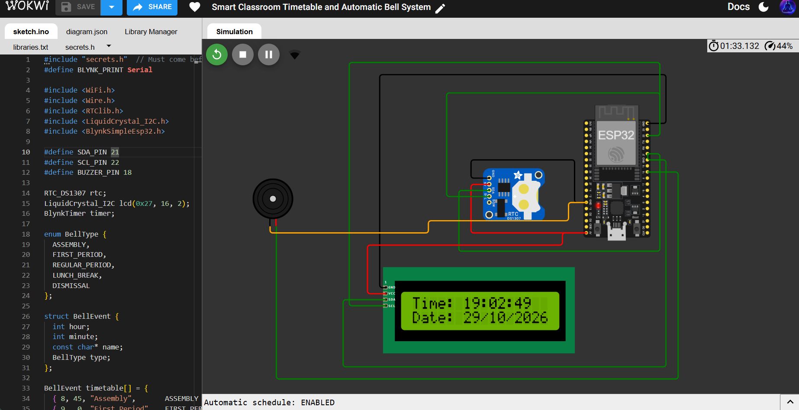
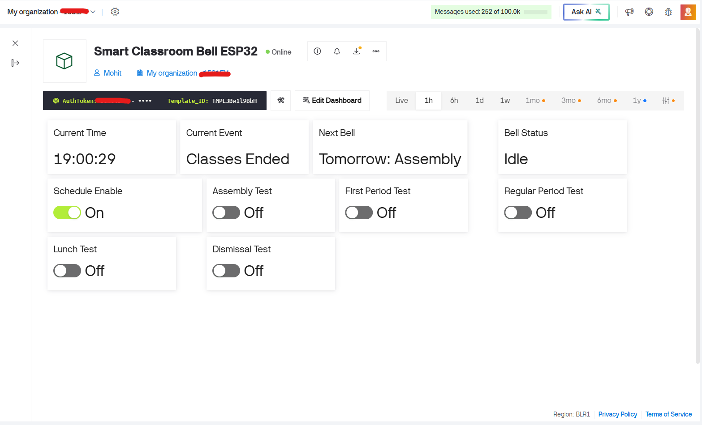
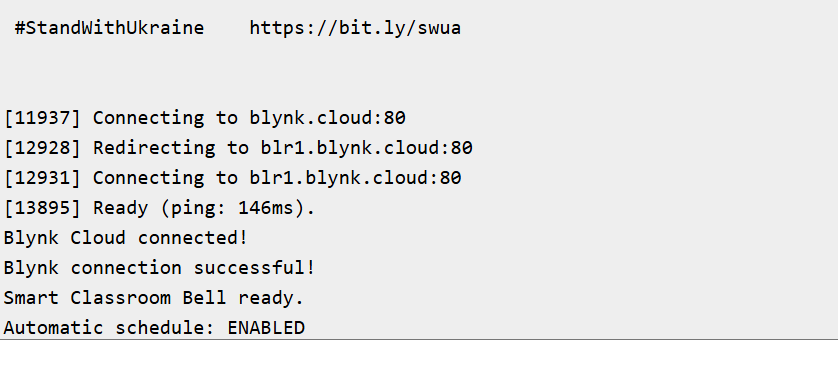
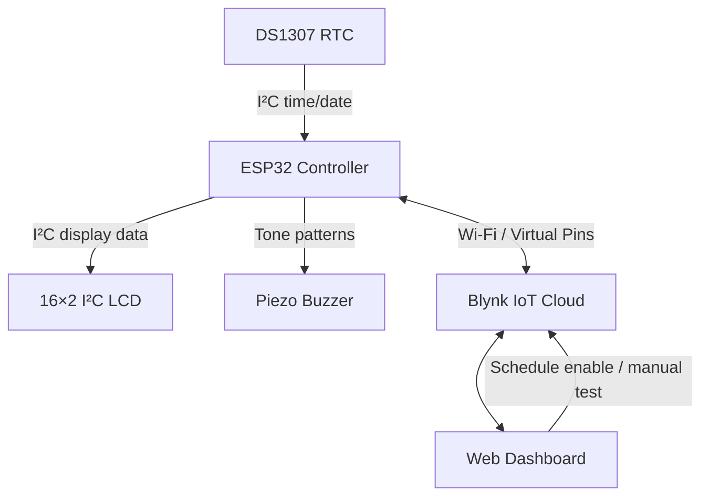

# 🔔 Smart Classroom Timetable & Automatic Bell System

**One timetable. Five signals. Zero manual bell-ringing.**

An ESP32-based classroom bell prototype that follows a configurable daily timetable and plays a different electronic tone pattern for morning assembly, the first period, regular periods, lunch break, and dismissal. The project combines an RTC clock, an I²C LCD, a piezo buzzer, the Wokwi online simulator, and Blynk IoT Cloud for live status monitoring and remote bell testing.

> **Project type:** Simulation-first IoT prototype  
> **Core platform:** Wokwi + ESP32 + Blynk IoT Cloud  
> **Hardware status:** Demonstrated in simulation; physical hardware has not been tested.

<p align="center">
  
</p>


---

## Contents

- [Project at a glance](#project-at-a-glance)
- [Live demonstrations](#live-demonstrations)
- [Features](#features)
- [System architecture](#system-architecture)
- [Bell sound design](#bell-sound-design)
- [Sample timetable](#sample-timetable)
- [Components and tools](#components-and-tools)
- [Circuit connections](#circuit-connections)
- [Blynk datastreams](#blynk-datastreams)
- [How it works](#how-it-works)
- [Run the project](#run-the-project)
- [Project structure](#project-structure)
- [Testing and current limitations](#testing-and-current-limitations)
- [Security notes](#security-notes)
- [Future roadmap](#future-roadmap)
- [Project team](#project-team)
- [License](#license)

## Project at a glance

A classroom bell is simple in principle, but a useful automated version needs dependable timing, clear event feedback, distinct alerts, and a way to test the system without waiting for the next period. This project brings those pieces together in a simulation that can be shown through a browser.

The ESP32 checks the timetable against the DS1307 real-time clock. When an event time matches, it selects that event's tone pattern and drives the piezo buzzer. The LCD shows the time/date and temporarily displays the event while its bell plays. When Wi-Fi and Blynk Cloud are connected, the device publishes dashboard values and accepts manual sound-test commands.

### Why it is different

- **Event-specific sound identity:** assembly, first period, regular periods, lunch, and dismissal each have a distinct tone pattern.
- **Automatic and manual operation:** scheduled events run automatically, while Blynk controls allow each tone to be demonstrated on demand.
- **Visible status:** an LCD and a cloud dashboard make the system easier to understand during a demonstration.
- **Simulation-first development:** the circuit and code can be tested online before considering real hardware.

## Live demonstrations

### 1. Wokwi circuit simulation

The Wokwi circuit contains the ESP32, DS1307 RTC, 16×2 I²C LCD, and piezo buzzer.

**Open the simulation:** [Launch Smart Classroom Bell Simulation](https://wokwi.com/projects/479200252850079745)


### 2. Blynk IoT dashboard

The Blynk dashboard is designed to show the current time, current event, next scheduled bell, bell status, and controls for automatic scheduling and manual sound tests.



> The dashboard may require access to the Blynk account that owns the device. Do not publish a device authentication token or other credentials.

### 3. Serial Monitor

The Serial Monitor provides connection messages and event logs, including Wi-Fi/Blynk connection status and the name of a bell event when it is triggered.




## Features

- Timetable-driven automatic bell triggering.
- Five distinguishable buzzer patterns:
  - Morning assembly
  - First period
  - Regular periods
  - Lunch break
  - Dismissal / end of classes
- Current time and date on a 16×2 I²C LCD.
- DS1307 RTC timekeeping.
- Blynk IoT Cloud connectivity through ESP32 Wi-Fi.
- Dashboard values for current time, current event, next bell, and bell status.
- Dashboard control to enable or disable automatic scheduling.
- Separate manual controls to test each bell pattern.
- Per-day duplicate-trigger protection for each scheduled event.
- Online simulation and browser-shareable demonstration.

## System architecture



The timetable and bell-pattern logic run on the ESP32. Blynk is used for monitoring and remote commands; the cloud is not the source of the scheduled time. If the cloud is disconnected, dashboard updates and remote controls are unavailable. Automatic bell scheduling can continue locally as long as the ESP32 simulation and RTC are running.

## Bell sound design

| Event | Pattern | Purpose |
|---|---|---|
| Assembly | Three short ascending tones | Morning assembly alert |
| First period | One long high tone | Start of the first period |
| Regular period | Two medium tones | Common signal for other periods |
| Lunch break | Two low, long tones | Lunch-break alert |
| Dismissal | Three descending tones | End of classes / chhutti |

These are **generated electronic tones**, not recordings of a traditional school bell. Frequencies and durations are defined in the firmware and can be adjusted to suit the demonstration.

## Sample timetable

The following times are example values configured in `sketch.ino`. Replace them with the timetable required for your institution.

| Time (24-hour format) | Event | Tone pattern |
|---|---|---|
| 08:45 | Assembly | Three short ascending tones |
| 09:00 | First period | One long high tone |
| 09:50 | Regular period | Two medium tones |
| 10:40 | Regular period | Two medium tones |
| 11:30 | Regular period | Two medium tones |
| 12:20 | Lunch break | Two low, long tones |
| 13:00 | Regular period | Two medium tones |
| 13:50 | Regular period | Two medium tones |
| 14:40 | Regular period | Two medium tones |
| 15:30 | Dismissal | Three descending tones |

**Tip:** For a quick simulation test, temporarily change one event to a minute or two ahead of the RTC's displayed time. After the test, restore the intended timetable. Avoid leaving test times in the final submission.

## Components and tools

### Simulation components

- ESP32 DevKit board
- DS1307 real-time clock (RTC) module
- 16×2 I²C LCD
- Piezo buzzer

### Software and services

- [Wokwi](https://wokwi.com/) — circuit and firmware simulation
- Arduino C++ framework — firmware
- [Blynk IoT Cloud](https://blynk.cloud/) — dashboard and remote controls
- `Blynk` Arduino library
- `RTClib` library
- `LiquidCrystal I2C` library
- GitHub — source code and documentation

## Circuit connections

The table below describes the intended Wokwi wiring. Use the project's `diagram.json` as the definitive record of the actual simulated connections.

| Component | Component pin | ESP32 connection | Purpose |
|---|---|---|---|
| DS1307 RTC | VCC | VIN / 5V in the simulation | RTC power |
| DS1307 RTC | GND | GND | Common ground |
| DS1307 RTC | SDA | GPIO 21 | I²C data |
| DS1307 RTC | SCL | GPIO 22 | I²C clock |
| 16×2 I²C LCD | VCC | VIN / 5V in the simulation | LCD power |
| 16×2 I²C LCD | GND | GND | Common ground |
| 16×2 I²C LCD | SDA | GPIO 21 | I²C data |
| 16×2 I²C LCD | SCL | GPIO 22 | I²C clock |
| Piezo buzzer | Positive | GPIO 18 | Buzzer signal |
| Piezo buzzer | Negative | GND | Ground return |

The RTC and LCD share the I²C bus. The commonly used addresses are `0x68` for the DS1307 and `0x27` for the LCD configuration used by the firmware.

> **Physical hardware warning:** This wiring was assembled for simulation. Before transferring it to a real ESP32, verify each module's supply voltage and I²C pull-up voltage. Do not connect a mains-powered classroom bell directly to an ESP32 GPIO.

## Blynk datastreams

The template uses the following Virtual Pins:

| Virtual pin | Datastream | Direction | Description |
|---|---|---|---|
| `V0` | Current Time | ESP32 → Cloud | Current RTC time as text |
| `V1` | Current Event | ESP32 → Cloud | Current timetable event |
| `V2` | Next Bell | ESP32 → Cloud | Next scheduled event and time |
| `V3` | Schedule Enable | Cloud → ESP32 | `1` enables automatic scheduling; `0` disables it |
| `V4` | Assembly Test | Cloud → ESP32 | Trigger assembly tone |
| `V5` | First Period Test | Cloud → ESP32 | Trigger first-period tone |
| `V6` | Regular Period Test | Cloud → ESP32 | Trigger regular-period tone |
| `V7` | Lunch Test | Cloud → ESP32 | Trigger lunch tone |
| `V8` | Dismissal Test | Cloud → ESP32 | Trigger dismissal tone |
| `V9` | Bell Status | ESP32 → Cloud | `Idle`, `Ringing`, or `Disabled` |

The manual test controls are intended to send a short `1` command and then reset to `0`, so a later press can trigger the same sound again. Configure the dashboard controls and datastream ranges consistently with these values.

## How it works

1. **Read the RTC:** The ESP32 reads the current date and time from the DS1307 through I²C.
2. **Check the timetable:** The firmware compares the current hour and minute with the events configured in the timetable array.
3. **Prevent duplicate triggers:** Each scheduled event is marked as triggered for the current date so it does not keep ringing repeatedly during the same minute.
4. **Play the event tone:** The selected event chooses its own frequency/duration pattern for the piezo buzzer.
5. **Update the LCD:** The display normally shows time/date and briefly shows the event while the bell plays.
6. **Publish dashboard data:** When Blynk is connected, the device reports current time, current event, next bell, and bell status.
7. **Handle manual commands:** Dashboard test controls trigger the matching tone independently of the automatic timetable.

## Run the project

### 1. Open the simulation

Open the Wokwi project using the link in [Live demonstrations](#live-demonstrations). Confirm that `sketch.ino` and `diagram.json` are present.

### 2. Install / verify libraries

Make sure `libraries.txt` contains these dependencies:

```text
Blynk
RTClib
LiquidCrystal I2C
```

`WiFi.h` and `Wire.h` are provided by the ESP32 Arduino environment.

### 3. Configure Blynk credentials

Create a private `secrets.h` file for local/simulation use, based on `secrets.h.example`, with your own template ID, template name, and device authentication token. Wokwi commonly uses the simulated Wi-Fi network `Wokwi-GUEST` with a blank password.

**Never commit `secrets.h` or paste a real token into a public README.**

### 4. Start and verify

1. Start the Wokwi simulation.
2. Open the Serial Monitor and use `115200` baud.
3. Look for the Wi-Fi and Blynk connection messages.
4. Confirm that the LCD displays a changing time and date.
5. Open the Blynk dashboard and verify the live values.
6. Trigger each manual sound-test control individually.
7. Temporarily set one schedule event close to the displayed RTC time to test automatic ringing, then restore the normal event time.

## Project structure

```text
smart-classroom-timetable-automatic-bell/
├── README.md
├── sketch.ino
├── diagram.json
├── libraries.txt
├── secrets.h.example
├── .gitignore
├── LICENSE
└── screenshots/
    ├── wokwi-circuit.png
    ├── blynk-dashboard.png
    └── serial-monitor.png
```

The private `secrets.h` file is intentionally excluded from version control. The example file should contain placeholders only. The screenshots listed above should be actual captures of this project, not generic reference images.

## Testing and current limitations

### Verified in simulation

- The LCD displayed the RTC time and date.
- The five distinct buzzer patterns played during the sound-test stage.
- The automatic schedule was tested using a temporary event time.
- The ESP32 connected to Wi-Fi and Blynk Cloud in Wokwi.
- Dashboard manual controls triggered the corresponding bell sounds.

### Current limitations

- The schedule is hard-coded in `sketch.ino`; timetable changes currently require editing and restarting the simulation.
- Events are configured for a daily timetable. Weekday-specific schedules, holidays, and calendar exceptions are not yet implemented.
- Bell tones are generated by a piezo buzzer and are not recorded audio.
- The current sound functions use blocking delays while a pattern plays. A non-blocking event/state-machine design would improve responsiveness if the project grows.
- Blynk dashboard access depends on the configured account, valid credentials, and cloud connectivity.
- The project has been demonstrated in simulation only; physical hardware and a full-scale electric bell have not been tested.

## Security notes

- Keep the real `secrets.h` file out of GitHub.
- Keep `.gitignore` configured to ignore `secrets.h`.
- Commit only `secrets.h.example` with placeholder values.
- Do not include authentication tokens in screenshots, issue reports, README files, or public simulation links.
- If a real token was exposed in a public project, regenerate/rotate it in Blynk before continuing to use the project.

## Future roadmap

The following improvements are planned and are **not claimed as implemented yet**:

- [ ] **Editable timetable:** Update period times from the Blynk dashboard instead of modifying firmware.
- [ ] **School-day profiles:** Support different schedules for different weekdays, holidays, exams, and special events.
- [ ] **Non-blocking bell engine:** Replace blocking delays with a state machine so Wi-Fi and dashboard commands remain responsive while tones play.
- [ ] **Time synchronisation:** Add optional NTP synchronisation and a safe fallback to RTC time.
- [ ] **Better event history:** Log bell events with date/time and show trends or history in the dashboard.
- [ ] **Notifications:** Send an alert if the device loses connectivity or an expected event is missed.
- [ ] **Improved manual control:** Add a stop/mute action, debounce/repeat protection, and clearer confirmation feedback.
- [ ] **Schedule safeguards:** Add configurable school start/end times, configurable bell duration, and validation for conflicting or duplicate events.
- [ ] **Configuration without reflashing:** Persist schedule settings using a safe configuration store.
- [ ] **Physical prototype:** Test a real RTC/LCD/buzzer and a properly isolated, suitably rated driver for an external bell.
- [ ] **Demo media:** Add a short narrated demonstration video and final screenshots.

## Project team


`Mohit Kumar` 
`Rohit Kumar` 
`Tasis Alwaz` 
`Prity Kumari` 
`Priyanshu Kumar` 

**Department:** Computer Science & Engineering (Artificial Intelligence & Machine Learning)  
**College:** Techno Main Salt Lake

## License

This project is licensed under the terms in the repository's `LICENSE` file. If the repository uses the MIT License, see [LICENSE](LICENSE) for the full text.

---

*Built as a simulation-first academic IoT project to explore embedded scheduling, RTC-based timekeeping, distinctive audio alerts, and cloud-connected monitoring.*
